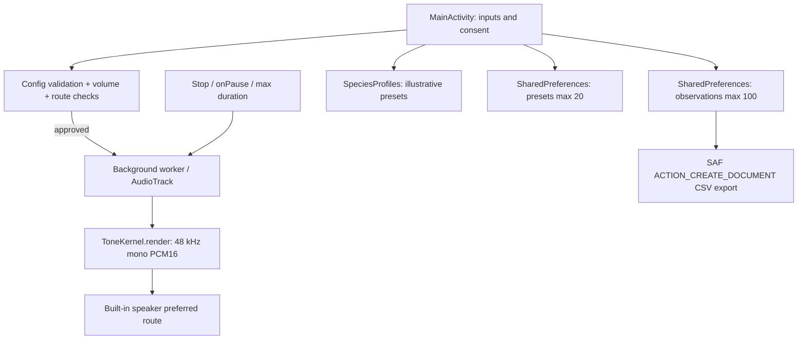

# PiFauna — current architecture and future UX

## Current code layout

```text
PiFauna/
├── app/src/main/java/com/methakon/pifauna/
│   ├── MainActivity.kt        # one scrollable native Activity, state/UI/audio lifecycle, local persistence, CSV
│   ├── SpeciesProfiles.kt    # fixed illustrative research-group ranges
│   └── ToneKernel.kt         # pure-Kotlin digital mono PCM synthesizer
├── app/src/main/AndroidManifest.xml
├── app/src/main/res/values/styles.xml
├── app/build.gradle.kts
├── tests/ToneKernelSmokeTest.kt
└── docs/...
```

The implementation is **one Android Activity**, not yet the four screens shown in Figma. Do not infer Figma navigation is already coded.

## Runtime data flow



## Core boundaries

- `ToneKernel`: pure math; takes absolute sample frame and prior phase; returns PCM samples and phase. Android-independent and unit-testable.
- `SpeciesProfiles`: reference names/bands/explanations. No machine-learning inference or validated repellency evidence.
- `MainActivity`: `AudioManager` checks, `AudioTrack` lifecycle, UI, SharedPreferences and export.

## Playback state

`Idle → Validating → Consent (first play per launch) → Playing → Completed / Stopped / Error → Idle`.

Stop triggers: user Stop, Activity paused, deadline reached, AudioTrack write error, route mismatch. A session counter invalidates an older worker when a new test starts. Audio may take a short hardware buffer drain to become silent; physical-device tests must verify this. A preferred speaker route is **not** proof that a device always routes as requested.

## Future architecture (not yet implemented)

Refactor to `ui/` screens, `audio/` engine/controller, `data/` preset & journal repositories, `domain/` research profiles and outcome models. Use lifecycle-aware observable state and route-change listeners where supported. Introduce export metadata versioning. **No microphones, sensors, camera capture, network or ESP32 in Mode A.**

## Dependencies and security

Gradle Android plugin + Kotlin plugin only; platform widgets and `AudioTrack`; no service, internet permission, telemetry or third-party SDKs. Data is local SharedPreferences JSON and exported through a user-selected URI. There is no encryption guarantee beyond Android OS app sandbox; do not store personally identifying notes in profile names.